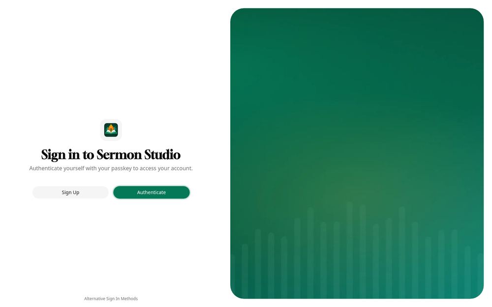
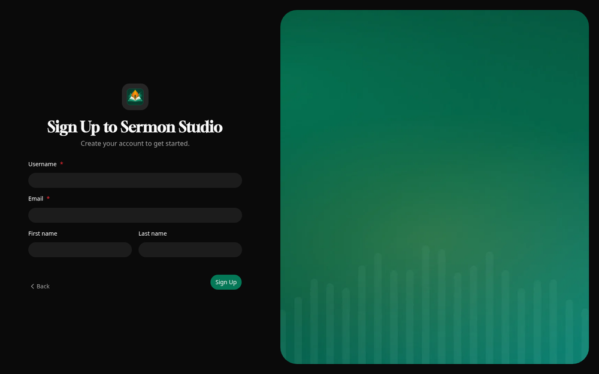
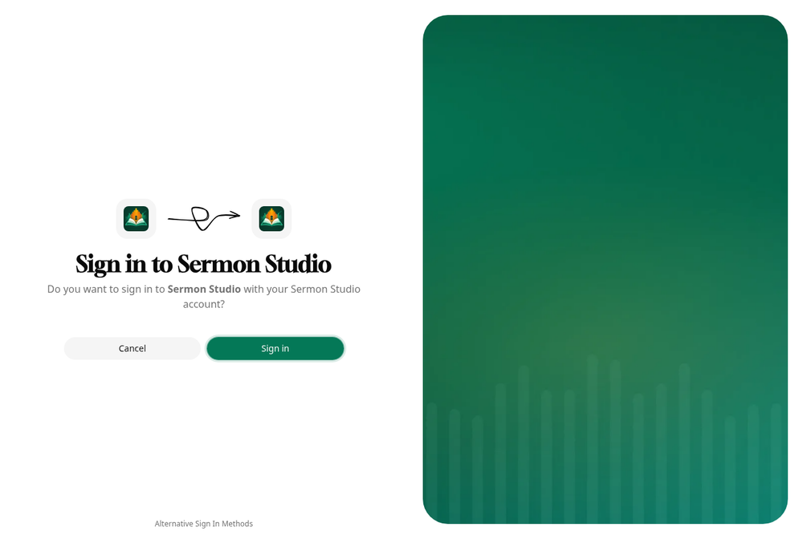
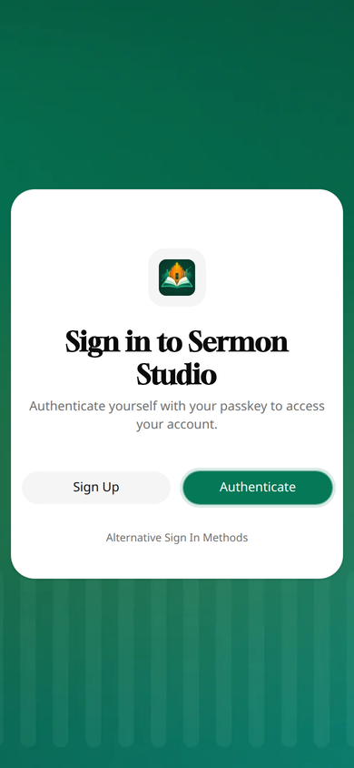

# Logging in with Pocket ID

[Pocket ID](https://pocket-id.org) is the recommended login for the studio: a small OpenID Connect provider where
people log in with a passkey, no passwords. This is the setup we recommend, checked against Pocket ID v2.14. How
access works in the studio itself (members, roles, invite links) is in [access.md](access.md); installing Pocket ID
is in [its own docs](https://pocket-id.org/docs).

In short: anyone can make an account in Pocket ID, and anyone with an account can log in to the studio, but they
see nothing until a church invites them. The studio's members decide who gets in, not Pocket ID.



Below, `<public-url>` is the studio's address as the browser sees it, like `https://sermons.example.org` (the
studio's `--public-url`), and `<pocket-id>` is Pocket ID's, like `https://id.example.org`.

## The client

In Pocket ID: **Settings → Administration → OIDC Clients → Add OIDC Client**.

| Field | Value |
|---|---|
| Name | `Sermon Studio` (shown on Pocket ID's pages) |
| Client Launch URL | `<public-url>/` (opened from Pocket ID's My Apps page) |
| Callback URLs | `<public-url>/auth/callback` |
| Logout Callback URLs | `<public-url>/auth/logout/callback` |
| Public Client | off: the studio is a confidential client, with a secret |
| PKCE | on |
| Requires Re-Authentication | optional: on asks for the passkey at every login, even when already logged in to Pocket ID |
| Skip Consent Screen | on is fine: the studio is your own app |
| Logo | `docs/pocket-id/client-logo.png` (the sun tab; the same works for the moon tab) |

Use exactly these two addresses, with no wildcards, though Pocket ID allows them. An exact address cannot be turned
into an open redirect: nobody can make Pocket ID send a login, or a logout, anywhere else.

Save, and on the client's page, under **Client secrets**, choose **Add client secret** (it can expire, or not) and
copy it: it is shown only once. The **Client ID** is on the same page.

Leave **Allowed User Groups** as it is: with no groups, any user can sign in to the client. Who sees which church is
decided in the studio, by its members.

**Logging out.** The studio's Log out also logs out of Pocket ID: it ends its own session, sends the browser to
Pocket ID's logout (with the ID token from the login, which Pocket ID requires), and Pocket ID sends it back to the
Logout Callback URL, which goes on to the studio's "You are logged out" page. Without the Logout Callback URL,
Pocket ID logs out but stays on its own page.

## Who can make an account

**Settings → Administration → Application Configuration → User Creation → Enable User Signups:**

- **Open Signup** (recommended): anyone can make an account, with a passkey, from the **Sign Up** button on the login
  page. An account alone gives nothing in the studio.
- **Signup with token**, the stricter choice: only people with a signup token can make an account. Make one under
  **Settings → Administration → Users**, in the menu by **Add User**: **Create Signup Token** (how many times it can be
  used, and until when), and send its link with the studio's invite link.
- **Disabled**: only Pocket ID's admins make accounts.



An invite link from the studio leads to Pocket ID's sign-in, which has no Sign Up button: someone without an account
makes one first, at `<pocket-id>/signup` (or **Sign Up** on `<pocket-id>/login`), then opens the invite link again.
Say so in the message with the link.

## The studio

The studio's settings are flags or environment variables (`SERMON_STUDIO_<FLAG>`). The client secret goes in a file:

```bash
sermon-studio --data-dir /data --public-url https://sermons.example.org/ \
  --oidc-issuer https://id.example.org --oidc-client-id <client id> \
  --oidc-client-secret-file /run/secrets/oidc/client-secret
```

On Kubernetes, as a ConfigMap and a Secret:

```yaml
apiVersion: v1
kind: ConfigMap
metadata:
  name: sermon-studio
data:
  SERMON_STUDIO_DATA_DIR: /data
  SERMON_STUDIO_PUBLIC_URL: https://sermons.example.org/
  SERMON_STUDIO_OIDC_ISSUER: https://id.example.org
  SERMON_STUDIO_OIDC_CLIENT_ID: <client id>
  SERMON_STUDIO_OIDC_CLIENT_SECRET_FILE: /run/secrets/oidc/client-secret
---
apiVersion: v1
kind: Secret
metadata:
  name: sermon-studio-oidc
stringData:
  client-secret: <client secret>
```

and in the Deployment's container:

```yaml
        envFrom:
          - configMapRef:
              name: sermon-studio
        volumeMounts:
          - name: oidc
            mountPath: /run/secrets/oidc
            readOnly: true
      volumes:
        - name: oidc
          secret:
            secretName: sermon-studio-oidc
```

The issuer is Pocket ID's address without a path or a trailing slash, as in its
`<pocket-id>/.well-known/openid-configuration`.

**The first invite.** With the login on, a church is for its members, so the first admin comes from the command
line, where the studio runs:

```bash
kubectl exec deploy/sermon-studio -- sermon-studio admin invite <church> --role admin
```

It prints a single-use link (the data folder and the public URL come from the same `SERMON_STUDIO_*` variables).
Make an account in Pocket ID, open the link, and accept. From then on that admin invites the others in the studio,
under **Settings → Members**.

## Styling

These make Pocket ID look like the studio. They apply to the whole Pocket ID instance, every app it logs in to, so
they suit a Pocket ID that is only for the studio.

The images are in [`docs/pocket-id/`](pocket-id/), made from the studio's logo by `scripts/make-pocket-id-assets.sh`.

**Settings → Administration → Application Configuration → General:**

- **Application Name:** `Sermon Studio` (the pages then say "Sign in to Sermon Studio").
- **Accent Color:** Custom, `#047857`.

**Application Configuration → Images:**

| Image | File |
|---|---|
| Favicon | `favicon.ico` (16, 32 and 48 px) |
| Light Mode Logo | `logo-light.svg` (or `.png`) |
| Dark Mode Logo | `logo-dark.svg` (or `.png`): the same tile, with a light rim |
| Background Image | `background.webp` (1920 × 1080) |

On a wide screen the background fills the panel beside the login, cropped to fit; on a phone it is behind the login
card. **The client's logo** (`client-logo.png`) is set on the client, above. With the light and dark logos set, the
sign-in page shows the studio's logo twice (Pocket ID's and the client's).





## Other providers

Any OpenID Connect provider works (Authentik, Keycloak, Google, Entra …). Register the studio as a client with:

- the callback (redirect URI) `<public-url>/auth/callback`;
- the scopes `openid profile email`;
- the authorization code flow with PKCE (S256), and a client secret if the provider gives one
  (`--oidc-client-secret-file`; without one the studio is a public client);
- the logout callback (post-logout redirect URI) `<public-url>/auth/logout/callback`, where the provider has one.

Log out ends the login at the provider too when its discovery document has an `end_session_endpoint`; without one,
only the studio's session ends.
